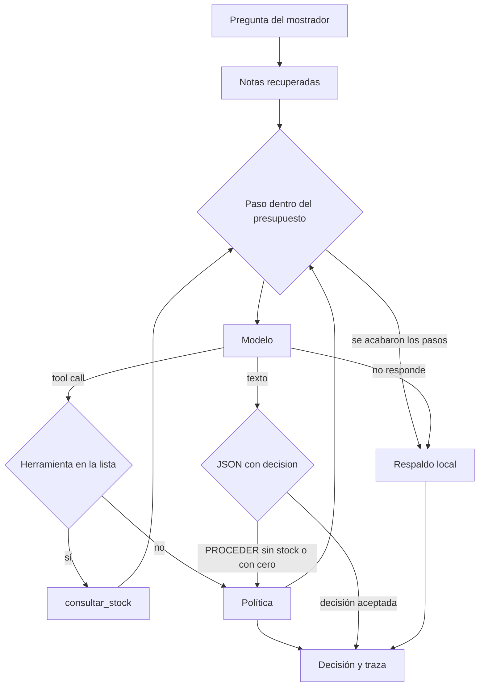

# Oficio de la IA

El mostrador pregunta si un pedido puede salir. Un modelo puede opinar, pero no toca el stock, no llama herramientas que no están en la lista y no se queda en un bucle.

## Concepto

Manejar un modelo es ponerle un contrato. El orquestador arma el contexto con notas locales, deja como máximo cuatro pasos y apunta cada uno en una traza. La única herramienta permitida es `consultar_stock`. Si el modelo dice que se puede entregar sin haberla llamado, la política baja la respuesta a revisión. Si el stock está en cero, no hay promesa. Si el modelo no contesta o gasta el presupuesto, entra un respaldo local. Sin `ANDEN_MODELO_URL` el modelo es local y determinista, para poder probar el circuito. Con esa URL se usa un endpoint compatible con `/v1/chat/completions`.

## Stack

| Pieza | Para qué |
| --- | --- |
| Python y FastAPI | `POST /consultas` y `GET /salud`. Puerto `3048`. |
| Puerto de modelo | `ModeloLocal` en las pruebas y el arranque. `ModeloHttp` si hay URL. |
| Herramientas | Lista blanca. Hoy solo `consultar_stock`. |
| Recuperación | Notas del oficio ordenadas por palabras en común con la pregunta. |
| Política | Veta un `PROCEDER` sin dato o con cantidad cero. |
| Presupuesto | Cuatro pasos. Después, el respaldo. |
| Traza | Modelo, herramienta, política y respaldo, en orden. |
| Evaluación | pytest con un modelo de guion, uno caído y un servidor HTTP local. |

## Flujo



## Correr

Desde esta carpeta:

```bash
python3 -m venv .venv
. .venv/bin/activate
pip install -r requirements.txt
pytest
PYTHONPATH=src python -m oficio.main
```

```bash
curl -s -X POST localhost:3048/consultas \
  -H 'content-type: application/json' \
  -d '{"pregunta":"¿hay arroz para el pedido urgente?"}'
```
